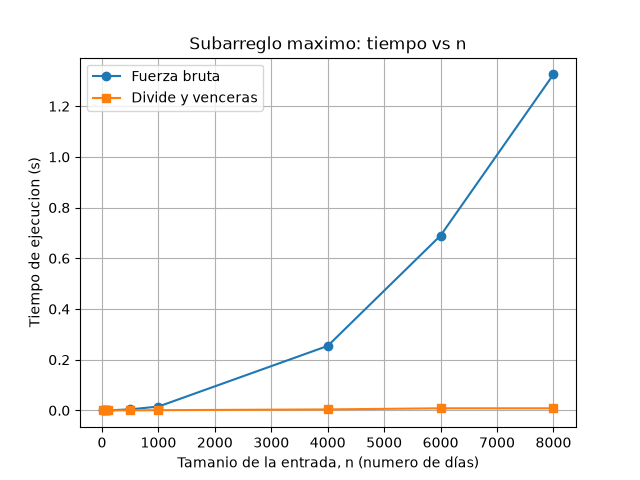

# Subarreglo máximo: fuerza bruta vs divide y vencerás

**Mateo Mesa Cardona**

## Cómo reproducir el experimento

Requisitos: Python 3.10 o superior y `matplotlib` (registrado en `requirements.txt`).
En mi equipo trabajo con la version de python 3.14.3

1. Activa el entorno virtual de la raíz del repositorio:

   | Sistema | Comando |
   |---|---|
   | Windows (PowerShell) | `.venv\Scripts\Activate.ps1` |
   | Windows (CMD) | `.venv\Scripts\activate.bat` |
   | macOS / Linux | `source .venv/bin/activate` |

2. Instala las dependencias (solo la primera vez) y entra a la carpeta del laboratorio:

   ```bash
   pip install -r requirements.txt
   cd lab2-divide-y-vencer
   ```

3. Ejecuta las pruebas (deben terminar con `Cada caso imprime una línea [OK] y al final un mensaje "Todas las pruebas pasaron"`):

   ```bash
   python pruebas.py
   ```

4. Ejecuta la medición que genera una tabla con la informacion "n | fuerza bruta (s) | divide y venceras (s) | suma" y guarda la gráfica en la `graficas` con nombre de archivo `tiempo_vs_n.png`:

   ```bash
   python medicion.py
   ```

## Parte 1 — Implementación y verificación

Código: [`subarreglo.py`](subarreglo.py) · [`pruebas.py`](pruebas.py)

El problema: Dada la variación diaria de caja de una tienda (positiva o negativa), se debe hallar el tramo de días consecutivos con la mayor suma. `subarreglo.py` implementa `subarreglo_fuerza_bruta` (Θ(n²)), `suma_cruzada` (Θ(n)) y `subarreglo_maximo` por divide y vencerás (Θ(n log n)). Las tres devuelven `(inicio, fin, suma)` con índices inclusivos y no modifican la lista recibida.

Para verificarlas, `pruebas.py` usa `assert` y compara las **sumas**, no los índices, porque en un empate cualquier tramo es válido. Además comprueba que los índices devueltos reproduzcan la suma reportada. Casos cubiertos:

- La serie de ocho días del enunciado: días 2 al 7, suma 17.
- Un solo elemento (positivo, negativo y cero).
- Todos los valores negativos y todos positivos.
- Un mejor tramo que cruza el punto medio, probado también llamando directo a `suma_cruzada`.
- Casos borde: máximo en cada extremo, empates, dos elementos y valores decimales.
- 30 listas aleatorias (longitud de 1 a 60) donde ambas funciones deben dar la misma suma, más dos listas de 50 elementos (sesgada a negativos y con decimales).

## Parte 2 — Medición

Código: [`medicion.py`](medicion.py)



Cómo medí:

- Tamaños: 10, 50, 100, 500, 1000, 4000, 6000, 8000.
- Datos: enteros entre -100 y 100 con semilla fija (`random.seed(42)`), y la **misma lista** para ambos algoritmos en cada tamaño.
- Repetí cada medición **5 veces** y reporto el promedio. El cronómetro (`time.perf_counter()`) envuelve solo la llamada al algoritmo, no la generación de datos.
- En cada tamaño verifico con un `assert` que ambos algoritmos devuelven la misma suma.

| n | Fuerza bruta (s) | Divide y vencerás (s) |
|---:|---:|---:|
| 10 | 0,000004 | 0,000007 |
| 50 | 0,000074 | 0,000063 |
| 100 | 0,000173 | 0,000073 |
| 500 | 0,004080 | 0,000425 |
| 1000 | 0,015178 | 0,000883 |
| 4000 | 0,254386 | 0,003898 |
| 6000 | 0,689810 | 0,008307 |
| 8000 | 1,325428 | 0,008263 |

## Parte 3 — Análisis

### 1. Recurrencia

`subarreglo_maximo` cumple **T(n) = 2·T(n/2) + Θ(n)**, con T(1) = Θ(1):

- **2 subproblemas:** uno por mitad, `inicio..medio` y `medio+1..fin`.
- **Tamaño n/2:** `medio = (inicio + fin) // 2` reparte los elementos por la mitad (⌈n/2⌉ y ⌊n/2⌋, sin cambiar el orden de crecimiento).
- **Θ(n):** `suma_cruzada` barre una vez hacia la izquierda desde `medio` y otra hacia la derecha desde `medio+1`; entre ambos barridos recorre cada elemento una sola vez. Comparar las tres sumas cuesta Θ(1). Se trabaja con índices, sin copiar sublistas.

**Método maestro:** a = 2, b = 2, f(n) = Θ(n). Como n^(log₂2) = n, se cumple f(n) = Θ(n^(log_b a)): **caso 2** (k = 0). Entonces T(n) = Θ(n log n).

**Fuerza bruta:** dos ciclos anidados recorren los n(n+1)/2 pares (i, j) con i ≤ j. Cada par cuesta Θ(1), porque la suma se acumula (`suma += valores[j]`) en vez de recalcularse. Total: Θ(n²).

### 2. Lo medido contra lo esperado

En la gráfica, la fuerza bruta se curva hacia arriba: de 4 microsegundos con n = 10 a 1,325 s con n = 8000. Divide y vencerás queda casi pegada al eje: 0,008 s con n = 8000, unas 160 veces menos.

Al duplicar n de 4000 a 8000:

- Fuerza bruta: 0,254 s → 1,325 s, **×5,21**. Θ(n²) predice ×4.
- Divide y vencerás: 0,0039 s → 0,0083 s, **×2,12**. Θ(n log n) predice 2·log₂8000 / log₂4000 ≈ **×2,17**.

Ambas coinciden con la teoría. La fila 500 → 1000 (En FB ×3,72 y en DV ×2,08) porque los tiempos son de milisegundos.

### 3. Tamaños pequeños

Sí hay un cruce. Con n = 10 gana la fuerza bruta (fb 4 microsegundos frente a dv 7 microsegundos); con n = 50 ya gana divide y vencerás, aunque por poco (dv 63 microsegundos frente a fb 74 microsegundos), y con n = 100 la ventaja es clara (dv 73 microsegundos frente a fb 173 microsegundos). El cruce está entre 10 y 50.

La razón es que Θ ignora constantes. Con n pequeño la fuerza bruta hace pocas iteraciones simples (n = 10 son 55 pares), mientras que divide y vencerás paga unas 2n − 1 llamadas recursivas, creación de tuplas y un barrido cruzado en cada división. Ese costo fijo solo se compensa cuando n² supera claramente a n log n.

### 4. ¿Cuándo conviene dividir?

Para el máximo de un arreglo, dividir en mitades, hallar el máximo de cada una y quedarse con el mayor cuesta Θ(1) por combinar (una comparación):

T(n) = 2·T(n/2) + Θ(1)

Con a = 2, b = 2 y n^(log₂2) = n, f(n) = Θ(1) = O(n^(1−ε)): **caso 1**, T(n) = Θ(n). Recorrer el arreglo una vez también es Θ(n) (n − 1 comparaciones). **Dividir no mejora**: hay que mirar cada elemento al menos una vez (Ω(n)) y la versión dividida solo agrega llamadas recursivas.

En el subarreglo máximo sí conviene: el algoritmo directo es superlineal (Θ(n²)) y combinar cuesta solo Θ(n), porque el barrido desde el medio evita examinar todos los pares que cruzan. Dividir vale la pena cuando el trabajo directo crece más rápido que el costo de combinar.

### 5. Concepto para la gerente

**Recomiendo divide y vencerás** (`subarreglo_maximo`).

**Estimación, no medición**, para n = 1.000.000. Se ajusta una constante con el punto más grande (n = 8000) y se proyecta con el modelo de cada algoritmo:

- Fuerza bruta: t ≈ c·n², con c = 1,325428 / 8000² ≈ 2,07·10⁻⁸ s. Resulta ≈ 2,07·10⁴ s, unas **5,75 horas (5 h 45 min)**.
- Divide y vencerás: t ≈ c·n·log₂n, con c = 0,008263 / (8000·log₂8000) ≈ 7,96·10⁻⁸ s. Resulta ≈ **1,6 segundos**.

No usé una regla de tres lineal porque ninguno crece como n: al multiplicar n por 125, la fuerza bruta se multiplica por 125² = 15.625, no por 125. La regla lineal daría unos 1.325 x125 = 1,66 ≈ 3 minutos y subestimaría 125 veces.

Es solo un orden de magnitud que supone constantes estables, y con 10⁶ datos la memoria y la caché pueden cambiarlas. Fuera de esta comparación existe un algoritmo Θ(n) (Kadane) que valdría la pena evaluar para series de ese tamaño.