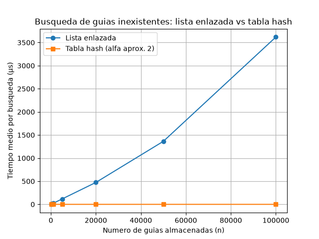
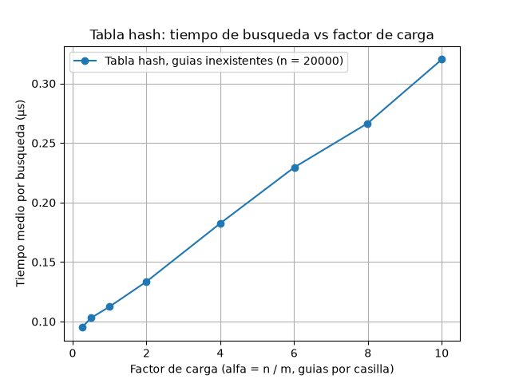

# Estructuras de datos: Rutas del Caribe

**Mateo Mesa Cardona**

## Cómo reproducir el experimento

Requisitos: Python 3.10 o superior y `matplotlib` (registrado en `requirements.txt`).
En mi equipo trabajo con la versión de python 3.14.3

1. Activa el entorno virtual de la raíz del repositorio:

   | Sistema | Comando |
   |---|---|
   | Windows (PowerShell) | `.venv\Scripts\Activate.ps1` |
   | Windows (CMD) | `.venv\Scripts\activate.bat` |
   | macOS / Linux | `source .venv/bin/activate` |

2. Instala las dependencias (solo la primera vez) y entra a la carpeta del laboratorio:

   ```bash
   pip install -r requirements.txt
   cd lab3-estructuras-datos
   ```

3. Ejecuta las pruebas (deben terminar con `un mensaje al final "Todas las pruebas pasaron"`):

   ```bash
   python pruebas.py
   ```

4. Ejecuta la medición que genera una tabla con la información "n | m | alfa | lista (us) | tabla (us) | lista/tabla" y guarda dos gráficas en la carpeta de `graficas` con nombres de archivo `lista_vs_tabla.png` y `tiempo_vs_alfa.png`:

   ```bash
   python medicion.py
   ```


## Parte 1 — Implementar y verificar las dos estructuras

Código: [`estructuras.py`](estructuras.py) · [`pruebas.py`](pruebas.py).

`ListaEnlazada` inserta al inicio en `Θ(1)` y busca recorriendo desde la cabeza. 
`TablaHash` tiene `m` casillas, cada una es una `ListaEnlazada` (encadenamiento) y utiliza `h(k) = k mod m` como función hash.

`pruebas.py` verifica los siguientes casos:

- **Búsqueda exitosa e infructuosa** en la lista y en la tabla, con las guías 10, 24 y 17. | Búsqueda infructuosa de la lista y de la tabla 99
- **Colisión forzada:** con `m = 7`, las guías 10, 24 y 17 caen en la casilla 3.
  Las tres guías se insertan y se recuperan, la lista de la casilla tres tiene longitud 3 y las otras seis casillas quedan vacías.
- **Factor de carga:** `factor_carga()` es `3 / 7` tras esas tres inserciones y 0 en una tabla vacía.
- **30 colecciones aleatorias** (con `m` de 7, 11, 101 y 997): para todas las guías existentes y 50 inexistentes por colección, la lista y la tabla devuelven lo mismo.


## Parte 2 — Medir y graficar

Código: [`medicion.py`](medicion.py).

### Experimento A — Lista frente a tabla



| n | m | alfa | Lista (µs) | Tabla (µs) |
|---:|---:|---:|---:|---:|
| 100 | 47 | 2,13 | 2,28 | 0,138 |
| 500 | 251 | 1,99 | 11,31 | 0,128 |
| 1.000 | 499 | 2,00 | 22,87 | 0,130 |
| 5.000 | 2.503 | 2,00 | 116,84 | 0,136 |
| 20.000 | 10.007 | 2,00 | 474,10 | 0,136 |
| 50.000 | 24.989 | 2,00 | 1.363,68 | 0,130 |
| 100.000 | 49.999 | 2,00 | 3.618,92 | 0,133 |

### Experimento B — Efecto del factor de carga



Con `n = 20.000` fijo:

| alfa obj. | m | alfa | Cadena max | Tabla (µs) |
|---:|---:|---:|---:|---:|
| 0,25 | 79.999 | 0,25 | 4 | 0,095 |
| 0,5 | 40.009 | 0,50 | 5 | 0,103 |
| 1 | 19.997 | 1,00 | 7 | 0,112 |
| 2 | 10.007 | 2,00 | 9 | 0,133 |
| 4 | 4.999 | 4,00 | 13 | 0,182 |
| 6 | 3.331 | 6,00 | 17 | 0,230 |
| 8 | 2.503 | 7,99 | 20 | 0,267 |
| 10 | 1.999 | 10,01 | 21 | 0,320 |

### Cómo se midió

- **Datos:** las guías son enteros distintos de diez dígitos, generados con semilla fija (42). 
  Las dos estructuras reciben las mismas guías, en el mismo orden.
- **Qué se busca:** en cada punto se hacen 200 búsquedas de guías que no existen, generadas con `generar_guias_inexistentes` (semilla 7). 
  Cada tiempo es el tiempo medio por búsqueda, en microsegundos (µs).
- **Cronómetro:** se utilizó `time.perf_counter()`, solo alrededor del ciclo de búsquedas.
  La construcción de las estructuras y la generación de los datos no se cronometran. 
  El recolector de basura se desactiva durante la medición.
- **Repeticiones:** cada punto se mide por lo menos 5 veces y se sigue repitiendo hasta acumular 1 segundo de medición (con un tope de 2.000 repeticiones). 
  Las búsquedas en la tabla duran menos de 1 µs, así que con pocas repeticiones el ruido del sistema las distorsiona. 
  El valor que grafica es la **mediana** de las repeticiones.
- **Tamaño de la tabla:** en el experimento A, `m` es el primo más cercano a `n / 2`, de modo que alfa queda cerca de 2 (valores de `m` en la tabla de arriba). 
  En el B, `m` es el primo más cercano a `20.000 / α`.

## Parte 3 — Análisis

### 1. Costo teórico

En la lista enlazada, una guía inexistente obliga a comparar con los `n` nodos antes de afirmar que no está, así que el costo es `Θ(n)`. En la tabla primero se calcula `h(k) = k mod m`, que cuesta `Θ(1)`, y luego solo se recorre la lista de esa casilla. Con `n` guías repartidas en `m` casillas, cada lista mide en promedio `α = n/m`, y una guía inexistente la recorre completa: `Θ(1 + α)`.

El resultado se sostiene en el supuesto de **hash uniforme simple**: cada guía tiene la misma probabilidad de caer en cualquier casilla, sin depender de las demás. Si todas cayeran en la misma casilla, habría una sola lista de `n` nodos y la
tabla costaría `Θ(n)`, igual de lenta que la lista original. Es necesario tener un balance de datos insertados en las casillas para que sea más óptima.

### 2. Lo medido contra lo esperado

**Gráfica 1.** Al pasar de `n = 50.000` a `n = 100.000` (n ×2), la lista pasa de 1.363,68 µs a 3.618,92 µs (**×2,6538**) y la tabla de 0,130 µs a 0,133 µs (**×1,02**). La tabla coincide con `Θ(1)`. La lista crece de forma proporcional a `n`, como en `Θ(n)`, aunque algo más de lo esperado (×2); puede ser por la memoria caché, que con muchos nodos se usa peor y hace cada salto más lento.

**Gráfica 2.** Con `n = 20.000`, el tiempo de la tabla crece en línea recta con α: de 0,095 µs con α = 0,25 a 0,320 µs con α = 10. Una recta aproximada es `t ≈ 0,089 + 0,023·α` (µs): una parte constante más una proporcional a α, lo que es coherente con `Θ(1 + α)`. El tiempo solo se multiplicó por 3,4 mientras α se multiplicó por 40, porque con α pequeño la parte constante pesa más.

### 3. Colisiones

Una colisión ocurre cuando dos guías distintas tienen el mismo `h(k)`. Pasa aunque `m > n` porque el hash reparte las guías "al azar" y no una por casilla. Con `m = 7`, las guías 10, 24 y 17 dan `10 % 7 = 3`, `24 % 7 = 3` y `17 % 7 = 3`: las tres chocan en la casilla 3.

- **Encadenamiento**: las tres guías quedan en la lista de la casilla 3. 
  *Ventaja:* es simple, nunca se llena y borrar es fácil.
  *Costo:* gasta memoria en punteros y usa mal la caché.
- **Direccionamiento abierto:** si la casilla está ocupada se prueba otra, por ejemplo la siguiente: 10 iría a la 3, 24 a la 4 y 17 a la 5. 
  *Ventaja:* sin punteros y mejor uso de la caché. 
  *Costo:* exige α < 1, se forman grupos ocupados que alargan las búsquedas y borrar es más complicado.

### 4. Tabla hash o árbol de búsqueda

Para "guías entre X y Y" la tabla hash **no sirve**: la función hash dispersa las guías sin respetar el orden, y guías cercanas caen en casillas sin relación. Habría que revisar las `n` guías, lo que cuesta `Θ(n)`.

El árbol de búsqueda binario guarda las claves ordenadas, así que baja hasta X en `O(h)` y con un recorrido en orden entrega las `k` guías del rango, en `O(h + k)`, sin mirar las demás.

Si las 400.000 guías llegaran ordenadas y se insertaran una a una, cada guía iría a la derecha ya que siempre que se inserte la guia es mayor y el árbol sería una lista: altura ≈ 400.000, búsqueda de una guía inexistente ≈ 400.000 comparaciones e insertarlas todas ≈ n²/2 = 8·10¹⁰.
Un árbol equilibrado tendría altura ≈ log₂(400.000) ≈ 19, o sea unas 19 comparaciones por búsqueda, unas 20.000 veces menos.

### 5. Concepto para la jefa de operaciones

Recomiendo **una combinación**: una tabla hash para el call center (consulta puntual, casi `Θ(1)`) y un árbol de búsqueda **equilibrado** para el rango, ambos apuntando a los mismos envíos. El costo es más memoria y actualizar dos estructuras por inserción. Si solo se pudiera una, escogería el árbol equilibrado que cubre ambas necesidades con ≈ 19 comparaciones.

**Estimación** (no es una medición) para una guía inexistente con 5.000.000 de
envíos:

- **Lista:** `Θ(n)`. Con n = 100.000 el costo por nodo fue 3.619 µs / 100.000 ≈ 0,036 µs, y ese costo subió con `n` (0,023 µs con n = 1.000 y con 20.000; 0,027 con 50.000) por la caché. Supongo 0,04 a 0,07 µs por nodo en 5.000.000 de nodos: **entre 0,2 y 0,35 segundos**.
- **Tabla:** si `m` crece con `n` y α se mantiene en ≈ 2, el costo sigue siendo constante: medí ≈ 0,13 µs, y por más fallos de caché estimo **entre 0,13 y 0,6 µs**. Con `m` fijo, α crecería con `n` y volvería a ser lineal.